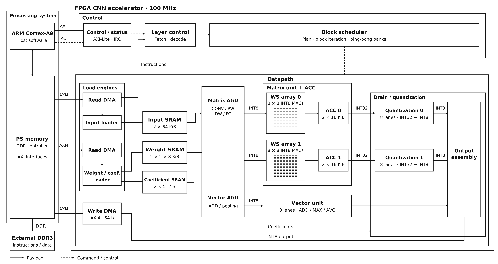
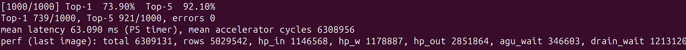
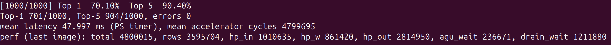
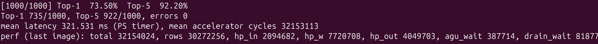
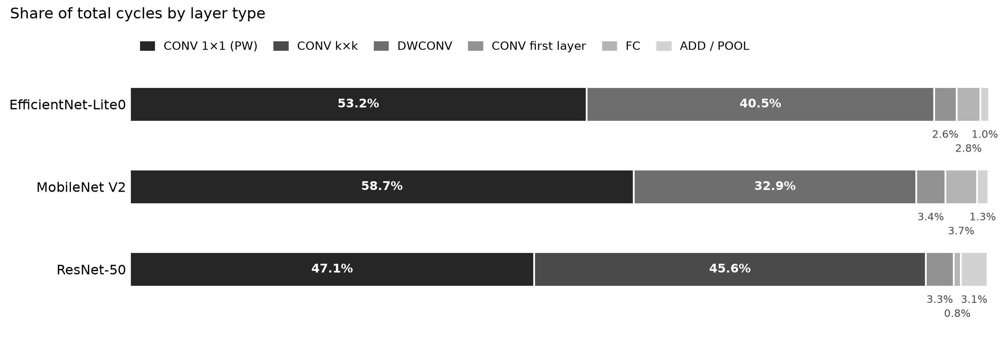

# FPGA-CNN-Accelerator

An INT8 CNN inference accelerator running at 100 MHz on a Zynq-7020 FPGA.
It runs EfficientNet-Lite0, MobileNet V2 and ResNet-50 end-to-end on the accelerator, and its output matches the INT8 model bit for bit.

## 1. Overview

- **Compute array:** two 8×8 weight-stationary systolic arrays (25.6 GOPS peak). Supports CONV, depthwise CONV and FC.
- **Vector unit:** supports ADD, MAXPOOL and AVGPOOL.
- **On-chip SRAM:** ping-pong buffers overlap DDR loads, compute and output writes.
- **Compiler:** converts an ONNX model into a layer-level instruction stream and `BOOT.bin`.

## 2. Architecture



| Group | Module | Role |
|---|---|---|
| Control | Control / status | AXI-Lite CSR, IRQ, performance counters |
| | Layer control | Fetches and decodes instructions from DDR, sequences layers |
| | Block scheduler | Computes block/tile sizes from the layer shape, iterates blocks per stage, owns ping-pong banks |
| Memory interface | Read DMA ×2 | AXI HP reads (input/instructions, weights/coefficients) |
| | Input loader, Weight / coef. loader | Writes DDR data into the free bank of each SRAM |
| | Write DMA | Writes INT8 outputs |
| Datapath | Matrix AGU | Weight preload, im2col, padding and byte alignment |
| | WS array ×2 + ACC ×2 | 8×8 INT8 MACs, INT32 accumulation (accumulate / overwrite) |
| | Vector AGU + Vector unit | ADD / MAXPOOL / AVGPOOL |
| | Drain / quantization | ACC → quantization → output layout assembly |

### Loop order

```text
for m_blk:                  # group of output pixels (a few output rows)
  for n_pair:               # 16 output channels (array 0: 8, array 1: 8)
    for k_blk:              # part of input channels × kernel positions (K)
      for tile in k_blk:    # 8 K values
        hold weights W[8 K][8 output channels] in the array
        stream m_blk pixels one row (8 K values) at a time → accumulate into ACC[pixel][channel]
    ACC → quantize → INT8 output   # written once, after all K are summed
```

- **Weight-stationary array:** weights stay fixed in the array for one tile, and only input pixels flow through.
- **Output-stationary loop:** an output block stays in the ACC until the K loop ends. Partial sums are never written to DDR.
- **Feature map layout:** each pixel's channels are stored contiguously, with the channel count padded to a multiple of 8. One 64-bit memory row holds 8 channels of one pixel.

### Buffers

| Buffer | Organization | Total |
|---|---|---:|
| Input SRAM | 2 banks × 64 KiB | 128 KiB |
| Weight SRAM | 2 banks × 2 arrays × 8 KiB | 32 KiB |
| Accumulator | 2 banks × 2 arrays × 512 rows × 8 × INT32 | 64 KiB |
| Coefficient SRAM | 2 banks × 64 channels × 8 B | 1 KiB |
| Total | | 225 KiB |

### Implementation (with PS, 100 MHz place and route)

| LUT | FF | BRAM36 | DSP | Setup WNS | Hold WHS |
|---:|---:|---:|---:|---:|---:|
| 30,313 (57%) | 20,653 (19%) | 60 (43%) | 182 (83%) | +0.279 ns | +0.018 ns |

- Percentages are XC7Z020 resource utilization.

## 3. Performance

Measured on a ZedBoard at 100 MHz with ImageNet val images 1–1000.

### Accuracy and latency

| Model | Top-1 / Top-5 | RTL simulation | Board | Board vs. simulation |
|---|---|---:|---:|---:|
| EfficientNet-Lite0 | 73.9% / 92.1% | 61.38 ms | 63.09 ms | +2.79% |
| MobileNet V2 | 70.1% / 90.4% | 46.07 ms | 48.00 ms | +4.19% |
| ResNet-50 | 73.5% / 92.2% | 320.48 ms | 321.53 ms | +0.33% |

### Board UART output







### Performance breakdown

| Metric | EfficientNet-Lite0 | MobileNet V2 | ResNet-50 | Mean | Row |
|---|---:|---:|---:|---:|---:|
| Array active cycles | 79.7% | 74.9% | 94.1% | 82.9% | 1 |
| Useful MACs (PE utilization) | 47.7% | 49.0% | 93.7% | 63.5% | 2 |
| Unused MACs | 32.0% | 26.0% | 0.4% | 19.5% | 3 |
| Tile switch cycles | 5.5% | 4.9% | 1.2% | 3.9% | 4 |
| Non-matrix cycles | 14.8% | 20.2% | 4.6% | 13.2% | 5 |
| Output write stalls | 19.2% | 25.2% | — | — | 6 |
| GOPS (25.6 peak) | 12.21 | 12.53 | 24.00 | 16.25 | 7 |

- Row 1: cycles in which an input row enters the array
- Row 2: MACs / (total cycles × 128)
- Row 3: Row 1 − Row 2
- Row 4: cycles spent waiting for weight preload/swap inside a block
- Row 5: 1 − Row 1 − Row 4
- Row 6: output write backpressure. It overlaps with compute, so it is not added to other rows.
- Row 7: 2 × MACs / mean latency
- Sums: Row 1 + Row 4 + Row 5 = 100%, Row 2 + Row 3 = Row 1

### Cycle share by layer type



- DWCONV uses only the 8 diagonal PEs out of 64, so its cycle share is large relative to its compute.

### Comparison with Cortex-A9

ncnn running on one Cortex-A9 core (666.67 MHz) of the same board, with NEON (SIMD) enabled. A9 latency is the mean of 10 runs.

| Model | Accelerator | A9 FP32 | A9 INT8 | vs. A9 INT8 |
|---|---:|---:|---:|---:|
| EfficientNet-Lite0 | 63.09 ms | 766.92 ms | 461.69 ms | **7.3×** |
| MobileNet V2 | 48.00 ms | 599.90 ms | 393.86 ms | **8.2×** |
| ResNet-50 | 321.53 ms | 5,362.00 ms | 2,058.62 ms | **6.4×** |


## 4. Build

### Environment

- Ubuntu 24.04.4 LTS
- Python 3.12
- Vivado/Vitis 2025.2: `source <Xilinx>/2025.2/Vitis/settings64.sh`
- `data/model/<name>.onnx`: float32 or INT8 QDQ model with a 1×3×H×W input.
  - Supported ops: Conv (group 1, depthwise), Gemm, Add, MaxPool, GlobalAveragePool, Relu, Clip
  - float32 models are converted to INT8 QDQ with onnxruntime static quantization.
- `data/model/<name>.yaml`: preprocessing settings (e.g. `data/model/resnet50.yaml`).
- `data/dataset/`: ImageNet val (`ILSVRC2012_img_val/`, `ILSVRC2012_devkit_t12/`)
- ONNX models and the dataset are not included in this repository.

### Commands

```bash
make hw                  # RTL → bitstream/XSA → Vitis platform        (build/hw/accel_hw.xsa)
make boot MODEL=<name>   # ONNX → INT8 → instructions/DDR image/firmware (build/<name>/BOOT.bin)
```

- On its first run, `make boot` creates `.venv` and installs `compiler/requirements.txt`.
- It processes 1000 images by default. Change this with `N=<count>`.
- When the board boots from `BOOT.bin`, it prints the following over UART (115200):
  - cumulative Top-1/Top-5 after each image
  - at the end, mean latency (PS timer) and performance counters

### Tests

```bash
source .venv/bin/activate
pytest -q compiler tb/unit     # compiler, RTL unit tests
pytest -q tb/integration       # layer regression (all three models: RUN_SLOW_MODELS=1)
```

### Directory layout

```text
rtl/        SystemVerilog RTL
tb/         cocotb tests (unit, integration, xsim)
compiler/   ONNX → layer IR, integer golden model, instruction/DDR image generation, cycle model
hw/         Vivado block design and place-and-route, Vitis platform
sw/         bare-metal firmware, BOOT.bin generation
data/       regmap.yaml, model preprocessing yaml
```
